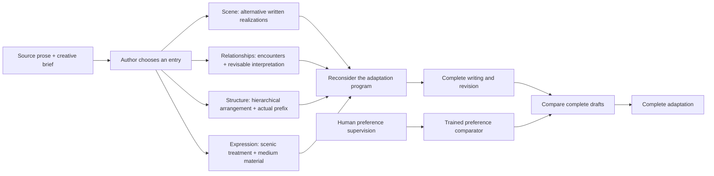

# SceneWeave

**Audience-Guided Scene Exploration for Dramatic Adaptation**

SceneWeave adapts prose into connected screenplays and stage scripts. Its central operation is to **write alternative realizations of a scene, then use those realizations to reconsider the whole adaptation**: character treatment, preceding preparation, subsequent development, and scene organization. A comparator learned from human and explicitly identified synthetic preferences supports selection among complete drafts.

Authors can begin with a scene, relationships, structure, or medium-specific expression. Source-conditioned entry selection is optional assistance. Plot, character actions, relationships, ending, background, props, arrangement, and expression can change within the creative brief. Fidelity, conflict intensity, ambiguity, and closure do not automatically determine quality.

## Architecture



The controllers maintain actual written material, program versions, and explicit edit operations. Relationship interpretations and reading suggestions remain revisable. The shared writer supports named-scene writing, complete-script realization, and complete-script revision. Planning, program updates, and reading roles can use the authorized API; creative roles can also use an explicitly bound local writer. Complete-script selection retains ties and unavailable judgments.

## Repository

| Directory | Contents |
|---|---|
| `experiments/` | Four-entry controllers, shared writer interfaces, matched controls, complete-draft selection, writer SFT and preference-model training |
| `tools/` | Checksum-based data restoration, explicit model download, and configurable Wiki transport |
| `data/` | Prepared compressed data, fixed source partitions, auxiliary human supervision, and a checksum catalog |
| `configs/` | Model identifiers, measured training environment, and an authored demonstration source |
| `third_party/` | Pinned official baseline prompts and the original StrandsDecider implementation |
| `tests/` | Offline contracts, controller behavior, preference symmetry, and portable-data checks |

Model weights, adapters, optimizer state, credentials, run logs, and the manuscript are excluded. This is a **public research code and data snapshot**; included third-party texts retain their original terms. No blanket license for redistributing all data is inferred.

## AI-assisted coding

Generative AI tools assisted code implementation. The authors are responsible for the correctness of the code.

## Installation

CPU controller tests need Python 3.10 or newer. Python 3.12 is recommended when using the local training stack.

```bash
python -m venv .venv
source .venv/bin/activate
pip install -r requirements.txt
python -m unittest discover -s tests -v
```

The local training reference environment uses Python 3.12.13, PyTorch 2.7.1 with CUDA 12.6, Transformers 5.19.0, PEFT 0.21.2, and an NVIDIA H100 80GB. Exact observed package versions are recorded in [`configs/environment.json`](configs/environment.json).

```bash
pip install -r requirements-train.txt
```

Install the appropriate PyTorch wheel for the device. Full-input memory profiling determines feasible batch sizes; the reference hardware does not imply another device supports the same sequence length or microbatch. Importing the controllers and restoring data do not initialize CUDA.

## Prepared data

Compressed files preserve the original complete input/target bytes. [`data/catalog.json`](data/catalog.json) records each file's origin, purpose, compressed and uncompressed SHA-256, and restoration path.

| Data | Snapshot | Intended use |
|---|---|---|
| Clean writer base | 3,391 retained TRAIN records; 96 unchanged DEV records | Candidate base for a later writer stage; current protection handoff and release readiness remain pending |
| Historical writer release | 3,397 TRAIN records | Preserve the actual earlier SFT input and parent exposure; do not combine with the clean base as additional examples |
| Existing creative-stage candidates | 288 records | Retained scene/script targets; already present in historical TRAIN, with incomplete coverage of newer route contexts |
| Other-entry requests | 366 source/brief requests from 122 TRAIN works | Sources for future generation; they have no generated targets and are not training records |
| Real prose/reference scenes | Original TRAIN/DEV correspondence records | Reference-scene supervision with work and author provenance; correspondence alone is not a quality preference |
| Current comparator data | 3,000 TRAIN pairs: 269 human and 2,731 synthetic; 83 DEV and 10 TEST | Request-conditioned preference training; human labels and synthetic labels remain distinguishable |
| New writer candidate snapshot | 588 actual candidate records, including 17 published-target records | Pending complete-input, source protection, duplicate and final quality admission; qualified new TRAIN count remains zero |
| Expert revisions and edit operations | Original prepared LAMP records | Modification supervision and observed-change analysis |
| HANNA | 1,056 stories, 836/110/110 split | Six separate human-rating dimensions; no invented total dramaticity score |
| Expert external material | 479 story records; 2,016 creative judgments | External judgment analysis; repeated judgments do not increase independent story counts |

Auxiliary data is preserved for its stated role and is not automatically admitted to the current training sets. The clean writer base is marked **not ready for a new training release**, in this archived data snapshot. Later writer stages require their own admitted release; packing or restoring these files does not admit them.

```bash
python tools/restore_data.py --verify-only
python tools/inspect_writer_candidates.py
python tools/restore_data.py --group writer
python tools/restore_data.py --group preferences
# Restore every prepared group if needed:
python tools/restore_data.py
```

Restored files live under `data/restored/`, which is ignored by Git. Restoration rejects changed archives and refuses to overwrite different existing data. Preserve the original TRAIN/DEV/TEST and work/author partitions; never use held-out preference labels to select training configurations.

See [`data/README.md`](data/README.md) for schema and provenance details.

## Offline preparation

The demonstration source is original, synthetic prose for checking the interface. It is not a real-novel evaluation example.

```bash
python experiments/run_adaptation_entry.py prepare \
  --sources configs/demo_sources.json \
  --out runs/demo \
  --entry scene_first \
  --execution-mode native_complete_v4
```

Other author-selected entries are `relationships_first`, `structure_first`, and `expression_first`. `auto` enables optional source-conditioned entry selection. Preparing a protocol performs no API inference and starts no training. The exported current material-development controller includes the four entry processes; explicit legacy modes remain available for compatibility.

## Authorized API execution

Copy `.env.example` to a local `.env` and supply the authorized Wiki endpoint and key. Export the values in the shell; the client does not load credentials from repository files.

```bash
export WIKI_API_BASE='https://your-authorized-gateway/v1'
export WIKI_API_KEY='your-local-key'
export WIKI_MODEL='gpt-6-luna'
```

The transport accepts only Wiki `gpt-6-luna`, checks the returned model identity, uses the native output allowance, and archives unresolved attempts without automatically retrying or substituting a model. Keys and local receipts are ignored by Git.

Scientific execution requires an actual applicable held-out evaluator report:

```bash
python experiments/run_adaptation_entry.py run \
  --out runs/demo \
  --evaluator-report /path/to/qualified_evaluator_report.json
```

A training dataset or a synthetic example is not an evaluator qualification report. `sceneweave_audience_selection.py` provides complete-draft selection with an explicitly bound comparator and common initialization. It checks both candidate orders and retains disagreements as unavailable judgments.

## Local models and training

The writer backbone is `Qwen/Qwen3.5-9B`, pinned to `c202236235762e1c871ad0ccb60c8ee5ba337b9a`. The preference-model backbone is `StrandsAgents/strands-decider-2B-hobson-v19`, retaining its original pointer head. [`configs/models.json`](configs/models.json) records their identifiers. No parameters are committed.

Model download is explicit and separate from tests or preparation:

```bash
python tools/download_models.py --model writer
python tools/download_models.py --model preference_comparator
```

`local_writer_inference.py` and `local_adaptation_writer_interface.py` bind actual local checkpoints, complete inputs, and response identities. `train_local_writer.py` provides complete-target, assistant-only SFT with length and partition preflight. It requires an explicit release for training; this snapshot does not authorize a new writer run. `train_tie_script_comparator.py` additionally models A, B, and genuine ties, keeping reader disagreement separate from indifference. Its artifact validators require original provenance. `train_contextual_script_comparator.py` trains complete request/candidate comparisons with ordinary LoRA, source weights, synthetic-only smoothing, and full-epoch validation. Do not substitute story-rating dimensions for screenplay preferences or treat dataset counts as evidence of model quality.

## Default preference evaluator weights

The default comparator is the retained **V9 epoch2** checkpoint. Its inference export is being deposited as a Zenodo draft; the deposit has not been published, and a public download link will be added after publication. The export contains all 378 trained adapter/head tensors, verified exactly equal to the original checkpoint, with optimizer and RNG state omitted. [`configs/evaluator_release.json`](configs/evaluator_release.json) records the original checkpoint SHA-256, export SHA-256, and pinned base-model revisions.

To load the weights when available, install the training dependencies, download both model dependencies, and place `sceneweave_evaluator_v9_epoch2.pt` under `models/`:

```bash
python tools/download_models.py --model preference_comparator
python tools/download_models.py --model preference_base
python experiments/predict_contextual_script_preference.py --pair pair.json
```

`pair.json` supplies `prompt`, `a`, and `b` as complete strings. Prediction preserves the native AB/BA semantic averaging and A/B/tie classes. Tie handling remains unvalidated; outputs express relative request-conditioned preference, without an absolute script-quality score.

## Method and baseline sources

- [SuperWriter, Findings of ACL 2026](https://aclanthology.org/2026.findings-acl.428/): official planning, writing, and refinement prompts, pinned to commit `436149d87908a462b5f74270cb43d797163f6e17`. The pure-function loader does not execute upstream network code. Prompt-workflow reuse and the official post-trained model are distinct configurations.
- [Dramaturge](https://arxiv.org/abs/2510.05188): character reading and local/global script editing; the archived appendix prompts retain their attribution.
- [DOME, NAACL 2025](https://aclanthology.org/2025.naacl-long.63/): dynamic hierarchical planning, informing prefix-conditioned development.
- [Reader–Rewriter](https://arxiv.org/abs/2503.15655): novel-to-screenplay adaptation and staged development.
- [Salesforce creative-writing evaluation and WritingRewards](https://github.com/salesforce/creativity_eval/tree/main/WritingRewards): original expert-writing and revision material.
- [StrandsDecider](https://huggingface.co/StrandsAgents/strands-decider-2B-hobson-v19): original open decision backbone and readout implementation.

See [`third_party/README.md`](third_party/README.md) for source and license boundaries. [`docs/source_export.json`](docs/source_export.json) records the original and exported hashes of the main modules and the limited path/template extraction changes needed for the standalone project.

Optional CPU tests for the three-way comparator use the training environment and pytest:

```bash
pip install -r requirements-test.txt
pytest -q tests/test_tie_script_comparator.py
```
