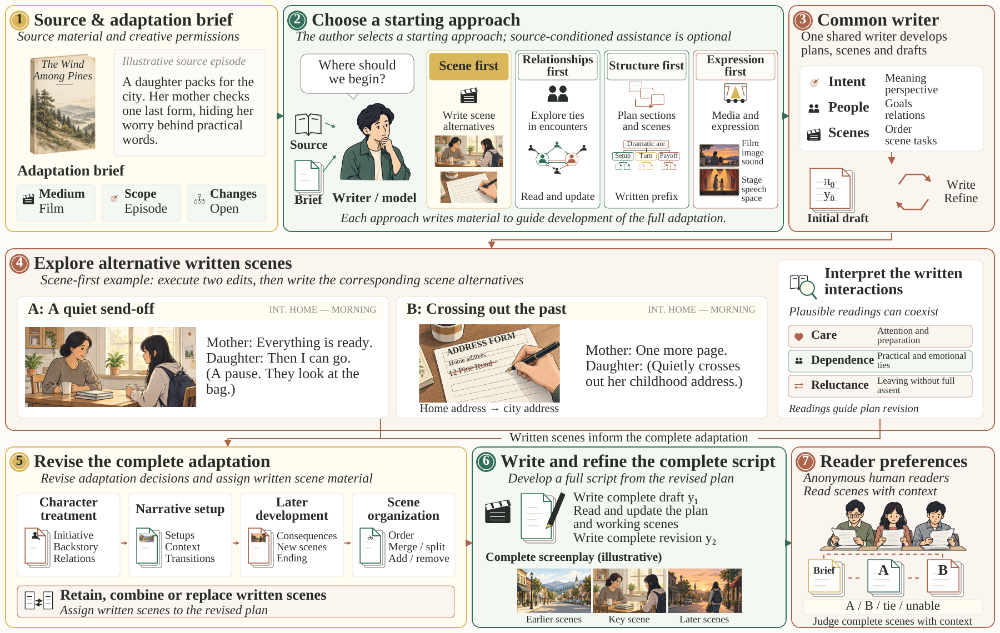

<p align="right">
  <a href="README.md"></a>
  <a href="README.zh-CN.md"></a>
</p>

# SceneWeave：以受众偏好引导场面探索的戏剧改编方法

SceneWeave 将叙事散文改编为前后连贯的影视剧本或舞台剧本。它的核心做法是**先写出同一场面的不同处理，再用写出的场面重新审视整个改编**：人物如何表现、前面如何铺垫、后续如何发展，以及场面如何组织。一个从人类偏好和明确标记的合成偏好中学习的比较模型，辅助选择完整稿件。

创作者可以从场面、人物关系、结构或媒介表达入手。根据原作选择切入点是可选的辅助功能。在改编任务允许的范围内，情节、人物行动、关系、结局、背景、道具、场面编排和表达方式都可以改变。忠于原作、冲突强度、含混程度和收束方式本身都不能决定质量。

## 论文

[SceneWeave: Audience-Guided Scene Exploration for Dramatic Adaptation](https://arxiv.org/abs/2610.21737) · [HTML 全文](https://arxiv.org/html/2610.21737) · [arXiv PDF](https://arxiv.org/pdf/2610.21737)

[模型与实验材料](https://doi.org/10.5281/zenodo.23329962)已发布于 Zenodo。

## 盲评

[打开中英双语盲评网站](https://107.174.142.168:8060/)。实验展示八组匿名场面文本，每组包含完整场面及其前后文。页面提供英文原文和中文译文；读者可以选择 A、B、平局或无法判断，并简述理由。评审过程中不显示方法身份。

## 系统结构



控制流程保存实际写出的文本、改编方案的各个版本，以及明确的修改操作。对人物关系的理解和阅读建议均可继续修订。共用写作器支持指定场面的写作、完整剧本生成和完整剧本修订。规划、方案更新和阅读环节可以使用获授权的 API；创作环节也可以绑定指定的本地写作模型。选择完整剧本时，系统保留平局和无法判断的结果。

## 仓库内容

| 目录 | 内容 |
|---|---|
| `experiments/` | 四种切入方式的控制流程、共用写作器接口、匹配的对照条件、完整稿件选择、写作器监督微调与偏好模型训练 |
| `tools/` | 基于校验和的数据恢复、显式模型下载和可配置的 Wiki 网关传输 |
| `data/` | 已整理的压缩数据、固定的原作划分、辅助人类标注和校验和目录 |
| `configs/` | 模型标识、实测训练环境和作者编写的演示原作 |
| `evaluation/dramabench/` | 论文使用的完整剧本内容标注、评分和汇总 |
| `third_party/` | 固定版本的官方基线提示词和原版 StrandsDecider 实现 |
| `tests/` | 离线接口约束、控制流程、偏好判断顺序对称性和数据可移植性检查 |

仓库不包含模型权重、适配器、优化器状态、凭据、运行日志和论文源文件。这是一份**公开的研究代码与数据快照**；所含第三方文本仍适用其原有条款，仓库不对全部数据作统一的再分发许可声明。

论文最终使用的比较模型和混合写作器训练配置见 [`configs/paper_comparator_training.json`](configs/paper_comparator_training.json) 与 [`configs/paper_hybrid_writer_training.json`](configs/paper_hybrid_writer_training.json)。[`evaluation/dramabench/README.md`](evaluation/dramabench/README.md) 说明完整剧本内容评估的输入要求和获授权的网关适配器。

## 安装

运行 CPU 控制流程测试需要 Python 3.10 或更新版本。使用本地训练环境时，建议采用 Python 3.12。

```bash
python -m venv .venv
source .venv/bin/activate
pip install -r requirements.txt
python -m unittest discover -s tests -v
```

本地训练的参考环境使用 Python 3.12.13、PyTorch 2.7.1（CUDA 12.6）、Transformers 5.19.0、PEFT 0.21.2 和一张 NVIDIA H100 80GB。实测的软件包版本记录于 [`configs/environment.json`](configs/environment.json)。

```bash
pip install -r requirements-train.txt
```

请安装与设备相应的 PyTorch 版本。可用批量大小应依据完整输入的显存测试确定；参考硬件配置不能保证其他设备支持相同的序列长度或微批量大小。导入控制流程和恢复数据不会初始化 CUDA。

## 已整理的数据

压缩文件保留完整输入与目标文本的原始字节。[`data/catalog.json`](data/catalog.json) 记录各文件的来源、用途、压缩前后的 SHA-256 以及恢复路径。

| 数据 | 快照规模 | 用途与边界 |
|---|---|---|
| 清理后的写作器基础数据 | 保留 3,391 条 TRAIN 记录；96 条未改动的 DEV 记录 | 后续写作器训练阶段的候选基础数据；数据保护移交及发布准备仍未完成 |
| 历史写作器发布数据 | 3,397 条 TRAIN 记录 | 保留先前监督微调的实际输入及上游模型接触过的数据；不得与清理后的基础数据相加，作为新增样本 |
| 已有创作阶段候选 | 288 条记录 | 保留场面或剧本目标文本；这些记录已经包含在历史 TRAIN 中，对较新的流程上下文覆盖不完整 |
| 其他切入方式的请求 | 来自 122 部 TRAIN 作品的 366 条原作及任务要求 | 用于后续生成；尚无生成目标文本，因此不属于训练记录 |
| 真实原作与参考场面 | 原始 TRAIN/DEV 对应关系记录 | 带作品和作者来源的参考场面监督；对应关系本身不构成质量偏好 |
| 当前比较模型数据 | 3,000 对 TRAIN：269 对人类标注、2,731 对合成标注；83 对 DEV、10 对 TEST | 根据任务要求训练偏好模型；人类标签与合成标签保持区分 |
| 新写作器候选快照 | 588 条实际候选记录，其中 17 条以已发表作品为目标文本 | 尚待完整输入、原作划分保护、去重及最终质量准入；目前合格的新增 TRAIN 数量为零 |
| 专家修改与编辑操作 | 原始整理的 LAMP 记录 | 修改监督与可观察变化分析 |
| HANNA | 1,056 篇故事，按 836/110/110 划分 | 六个独立的人类评分维度；未构造整体“戏剧性”总分 |
| 外部专家材料 | 479 篇故事记录；2,016 条创作判断 | 用于外部判断分析；同一故事的重复判断不增加独立故事数量 |

辅助数据按各自用途保存，不会自动加入当前训练集。在这份存档快照中，清理后的写作器基础数据标为**尚不具备发布新训练集的条件**。后续写作器阶段需要单独完成数据准入；打包或恢复文件本身不构成准入。

```bash
python tools/restore_data.py --verify-only
python tools/inspect_writer_candidates.py
python tools/restore_data.py --group writer
python tools/restore_data.py --group preferences
# Restore every prepared group if needed:
python tools/restore_data.py
```

恢复后的文件位于 `data/restored/`，该目录已被 Git 忽略。恢复程序会拒绝已变动的压缩包，也不会覆盖内容不同的已有文件。请保留原有 TRAIN/DEV/TEST 划分，以及按作品和作者划分的数据边界；不得用留出的偏好测试标签选择训练配置。

数据结构和来源详见 [`data/README.md`](data/README.md)。

## 离线准备

演示原作是为检查接口而编写的合成散文，不能作为真实小说评估样本。

```bash
python experiments/run_adaptation_entry.py prepare \
  --sources configs/demo_sources.json \
  --out runs/demo \
  --entry scene_first \
  --execution-mode native_complete_v4
```

其他由作者指定的切入方式包括 `relationships_first`、`structure_first` 和 `expression_first`。`auto` 可根据原作内容辅助选择切入方式。准备流程不调用 API，也不启动训练。当前导出的文本开发控制流程包含这四种切入方式；明确指定的旧模式仍可用于兼容。

## 使用获授权的 API

将 `.env.example` 复制为本地 `.env`，填入获授权的 Wiki 网关地址和密钥，再在 shell 中导出这些值。客户端不会自行读取仓库文件中的凭据。

```bash
export WIKI_API_BASE='https://your-authorized-gateway/v1'
export WIKI_API_KEY='your-local-key'
export WIKI_MODEL='gpt-6-luna'
```

传输层仅接受 Wiki `gpt-6-luna`，会核对实际返回的模型标识，使用模型原生的输出额度，并保存未解决的调用记录；它不会自动重试或更换模型。密钥和本地记录已被 Git 忽略。

用于研究实验的运行需要一份实际适用的留出集评价器报告：

```bash
python experiments/run_adaptation_entry.py run \
  --out runs/demo \
  --evaluator-report /path/to/qualified_evaluator_report.json
```

训练数据集或合成样例不能充当评价器合格报告。`sceneweave_audience_selection.py` 在明确绑定比较模型、共用初始稿的条件下选择完整稿件。它会检查候选的两种呈现顺序，并将意见冲突保留为无法判断。

## 本地模型与训练

写作器基础模型为 `Qwen/Qwen3.5-9B`，固定修订号为 `c202236235762e1c871ad0ccb60c8ee5ba337b9a`。偏好模型的基础模型为 `StrandsAgents/strands-decider-2B-hobson-v19`，保留其原有的指针式决策头。模型标识记录于 [`configs/models.json`](configs/models.json)。仓库不提交模型参数。

模型下载需显式执行，与测试及准备步骤分开：

```bash
python tools/download_models.py --model writer
python tools/download_models.py --model preference_comparator
```

`local_writer_inference.py` 和 `local_adaptation_writer_interface.py` 用于绑定实际的本地检查点、完整输入和返回标识。`train_local_writer.py` 进行完整目标文本、仅对助手输出计算损失的监督微调，并预先检查长度与数据划分。训练需要显式指定已发布的数据版本；这份快照尚未授权新的写作器训练。`train_tie_script_comparator.py` 另外建模 A、B 和真正的平局，并区分读者意见分歧与无差别判断；其产物校验要求保留原始来源。`train_contextual_script_comparator.py` 使用普通 LoRA、来源权重、仅针对合成数据的标签软化和完整轮次验证，训练基于任务要求与候选稿件的比较模型。故事评分维度不能替代剧本偏好；数据量也不能单独证明模型质量。

## 默认偏好评价器权重

默认比较模型采用保留的 **V9 第 2 轮**检查点。推理权重可从已发布的 [Zenodo 记录](https://doi.org/10.5281/zenodo.23329962)取得。导出文件包含全部 378 个训练所得的适配器及决策头张量；历史核对记录显示它们与原检查点完全一致，导出时省略了优化器与随机数状态。[`configs/evaluator_release.json`](configs/evaluator_release.json) 记录原检查点及导出文件的 SHA-256，以及固定的基础模型修订号。

加载权重前，请安装训练依赖，下载两个模型依赖，并将 `sceneweave_evaluator_v9_epoch2.pt` 放入 `models/`：

```bash
python tools/download_models.py --model preference_comparator
python tools/download_models.py --model preference_base
python experiments/predict_contextual_script_preference.py --pair pair.json
```

`pair.json` 中的 `prompt`、`a` 和 `b` 均为完整字符串。预测保留原有的 AB/BA 语义平均及 A/B/平局三类输出。平局处理尚未得到验证；输出表示在给定任务要求下的相对偏好，不表示剧本质量的绝对分数。

## 方法与基线来源

- [SuperWriter，Findings of ACL 2026](https://aclanthology.org/2026.findings-acl.428/)：官方规划、写作和修订提示词，固定于提交 `436149d87908a462b5f74270cb43d797163f6e17`。纯函数加载器不会执行上游网络代码。复用提示词流程与使用官方后训练模型是两种不同配置。
- [Dramaturge](https://arxiv.org/abs/2510.05188)：人物解读及局部、整体剧本编辑；存档的附录提示词保留来源标注。
- [DOME，NAACL 2025](https://aclanthology.org/2025.naacl-long.63/)：动态层级规划，为按前文条件生成的开发过程提供参考。
- [Reader–Rewriter](https://arxiv.org/abs/2503.15655)：小说到剧本的改编与分阶段开发。
- [Salesforce 创意写作评估与 WritingRewards](https://github.com/salesforce/creativity_eval/tree/main/WritingRewards)：原始专家写作与修改材料。
- [StrandsDecider](https://huggingface.co/StrandsAgents/strands-decider-2B-hobson-v19)：原始开源决策基础模型及读出头实现。

第三方来源与许可边界见 [`third_party/README.md`](third_party/README.md)。[`docs/source_export.json`](docs/source_export.json) 记录主要模块原始文件与导出文件的哈希值，以及为独立仓库提取代码时所作的少量路径和模板调整。

三分类比较模型的可选 CPU 测试使用训练环境和 pytest：

```bash
pip install -r requirements-test.txt
pytest -q tests/test_tie_script_comparator.py
```

## 引用

引用论文时请使用 arXiv 记录；引用已发布的模型和实验材料时请另引 Zenodo DOI。

```bibtex
@misc{li2026sceneweave,
  author = {Li, Aolin and Xu, Xiao and Xie, Haihua},
  title = {SceneWeave: Audience-Guided Scene Exploration for Dramatic Adaptation},
  year = {2026},
  eprint = {2610.21737},
  archivePrefix = {arXiv},
  primaryClass = {cs.CL},
  url = {https://arxiv.org/abs/2610.21737}
}

@misc{li2026sceneweave_artifacts,
  author = {Li, Aolin and Xu, Xiao and Xie, Haihua},
  title = {SceneWeave: Models and Experimental Materials for Dramatic Adaptation},
  year = {2026},
  doi = {10.5281/zenodo.23329962},
  url = {https://doi.org/10.5281/zenodo.23329962}
}
```
