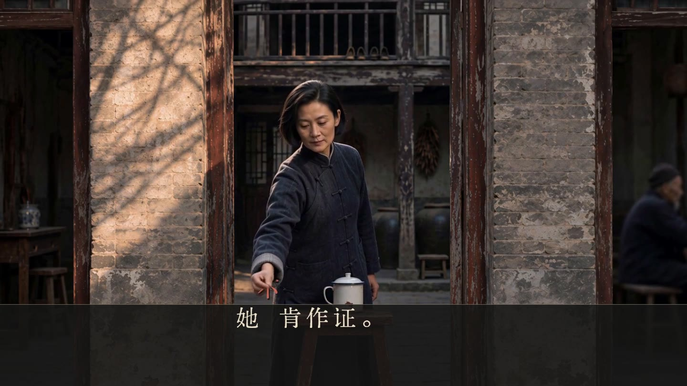

# 散角龙 · 电影 Agent

把中文小说做成有情节的电影。导入 EPUB 或小说正文，可以制作一部全书宣传片、一个完整的单故事，或从头讲到结局的长片。

*《五香街·她肯作证》影片截图。她把字幕里的「不」拿走，街坊对她的判词少了一个字。*

## 可以制作什么

- **全书宣传片**　从全书提炼人物冲突、转折与悬念，呈现作品独有的世界与气质。
- **单故事与长片**　把一个完整故事或全书情节拍成有起因、抉择和结果的影片。
- **画面与声音**　支持人物和场景设定、分镜、影片风格选择、中文角色对白和旁白、音乐与空间音效。
- **审看与交付**　可审看镜头和剪辑版本，支持定点返修、导出 MP4 与可编辑 OpenFilm 工程。

散角龙使用 SceneWeave 进行小说改编与台本创作，结合 MiniMax H3、程序动画、合成剪辑工具与美学 Skills 完成影片制作。

[了解 SceneWeave](../../README.zh-CN.md)
